<a href="https://shaxriyor.me">
  <picture>
    <source media="(prefers-color-scheme: dark)" srcset="./assets/hero-dark.svg">
    
  </picture>
</a>

I build marketplaces, Telegram bots and the money logic behind them. Most of it lives in the CS2 skin economy: prices, trades, deliveries, and the ledgers that keep them honest. When a site won't tell me something, I write a bot that asks it every minute.

Business Information Systems at Westminster International University in Tashkent gave me the business half. The rest I learn by shipping.

  <picture>
    <source media="(prefers-color-scheme: dark)" srcset="./assets/loop-dark.svg">
    
  </picture>
  <picture>
    <source media="(prefers-color-scheme: dark)" srcset="./assets/activity-dark.svg">
    
  </picture>
  <picture>
    <source media="(prefers-color-scheme: dark)" srcset="./assets/stats-dark.svg">
    
  </picture>
  <picture>
    <source media="(prefers-color-scheme: dark)" srcset="./assets/stack-dark.svg">
    
  </picture>

###### Selected work

  <a href="https://train.shaxriyor.me"><picture>
    <source media="(prefers-color-scheme: dark)" srcset="./assets/project-uzrail-dark.svg">
    
  </picture></a>
  <a href="https://github.com/sherryuser/cake-blow"><picture>
    <source media="(prefers-color-scheme: dark)" srcset="./assets/project-cake-blow-dark.svg">
    
  </picture></a>
  <a href="https://github.com/sherryuser/telegram-anon-qa-bot"><picture>
    <source media="(prefers-color-scheme: dark)" srcset="./assets/project-anon-qa-dark.svg">
    
  </picture></a>
  <a href="https://github.com/sherryuser/ArduinoWebLamp"><picture>
    <source media="(prefers-color-scheme: dark)" srcset="./assets/project-arduino-lamp-dark.svg">
    
  </picture></a>
  <a href="https://github.com/sherryuser/games-manager"><picture>
    <source media="(prefers-color-scheme: dark)" srcset="./assets/project-games-manager-dark.svg">
    
  </picture></a>
  <a href="https://shaxriyor.me"><picture>
    <source media="(prefers-color-scheme: dark)" srcset="./assets/project-site-dark.svg">
    
  </picture></a>

###### Say hi

  <a href="https://shaxriyor.me"><picture>
    <source media="(prefers-color-scheme: dark)" srcset="./assets/link-site-dark.svg">
    
  </picture></a>
  <a href="https://t.me/sherryuser"><picture>
    <source media="(prefers-color-scheme: dark)" srcset="./assets/link-telegram-dark.svg">
    
  </picture></a>
  <a href="https://x.com/sherryuser"><picture>
    <source media="(prefers-color-scheme: dark)" srcset="./assets/link-x-dark.svg">
    
  </picture></a>
  <a href="https://linkedin.com/in/sherryuser"><picture>
    <source media="(prefers-color-scheme: dark)" srcset="./assets/link-linkedin-dark.svg">
    
  </picture></a>
  <a href="https://instagram.com/sherryuser"><picture>
    <source media="(prefers-color-scheme: dark)" srcset="./assets/link-instagram-dark.svg">
    
  </picture></a>
  <a href="mailto:sherryuser1@gmail.com"><picture>
    <source media="(prefers-color-scheme: dark)" srcset="./assets/link-email-dark.svg">
    
  </picture></a>

