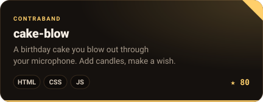
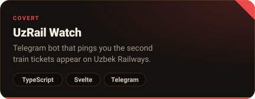
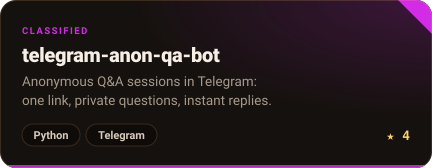
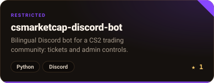
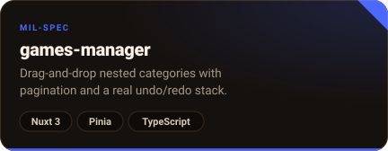
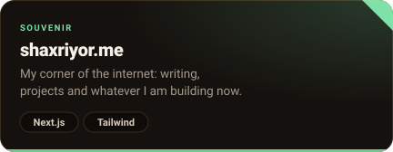
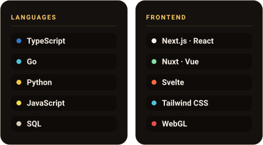
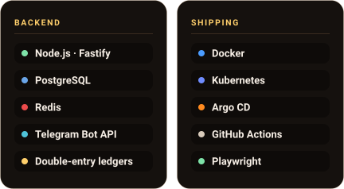

  
  

I'm **Shaxriyor**, a full-stack engineer in Tashkent. I build marketplaces, Telegram bots and the money logic behind them, and most of it lives in the CS2 skin economy: prices, floats, deliveries, and the ledgers that keep them honest. When a site won't tell me something, I write a bot that asks it every minute.

### Inventory

  
  
  
  
  
  

### Loadout

  
  

### Trade offers welcome

  
  
  
  
  
  

Every image here is drawn by <a href="./scripts/build.mjs">one small script</a> in this repository: no third-party cards, nothing to go down. <code>node scripts/build.mjs --refresh</code> updates the figures.
